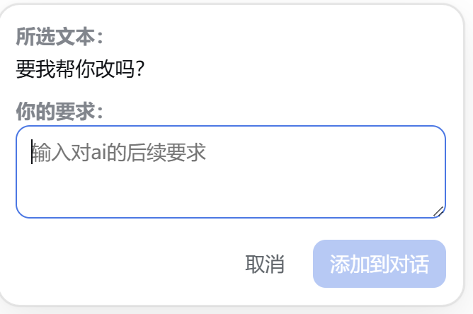
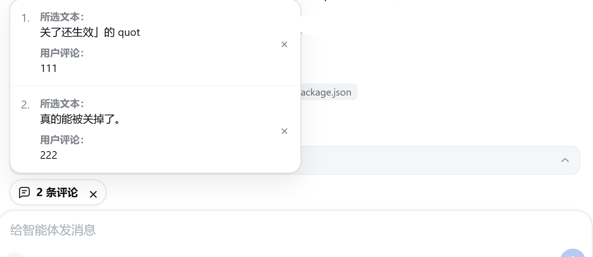

# DSH Multi-Selection Comments

English | [简体中文](README.md)

Bring Codex-style multiple, independent selection comments to DeepSeek Harness (DSH).

Select several passages from an AI's final response—or from a file preview open in the Sidebar—write a separate comment for each selection, and send them together as structured context with your main message, without cluttering the composer. Think reasoning, tool output, and non-AI messages never trigger the popup.

## Preview

### Comment on one selected passage



### Review multiple independent comments



## Features

- Codex-inspired selection commenting: select text and comment directly on that passage.
- Add multiple comments in sequence; every “selected text + user comment” pair stays independent.
- Comment on Sidebar file previews too: text/diff, Markdown, code, HTML, and image previews, the per-turn change review, plus the workspace file tree.
- Sidebar quotes automatically carry the file path, so the model knows which document the passage came from.
- Annotate web pages open in the Sidebar browser, Codex-style: a chat-bubble icon beside the address bar turns on hover-highlight element picking, and plain text selection keeps working.
- Page annotations carry the URL, a CSS selector, and a tag outline, so the model can locate the exact spot on the page.
- Keep the composer clean with a compact “N comments” capsule instead of stacked blockquotes.
- Open the capsule to review or remove individual comments; click outside the panel to close it.
- Press Enter to add a selection to the conversation; use Ctrl/Command+Enter for a newline.
- The comment is optional, so selected text can be attached without an additional instruction.
- Submit selections even when the main composer is otherwise empty.
- Inject structured comment context only when the main message is submitted.
- Render sent comments as a right-aligned annotation capsule instead of exposing raw XML.
- Trigger only in final AI output; ignore Think reasoning, tool output, user messages, inputs, editable regions, and steering messages.
- Follow the DSH page language for Chinese and English UI labels.

## Windows Installation

Node.js, npm, and a working DSH installation are required.

```powershell
git clone https://github.com/yuanc1204/dsh-multi-selection-comments.git
cd dsh-multi-selection-comments
powershell -ExecutionPolicy Bypass -File .\install.ps1
```

The installer will:

1. Install dependencies, then run type checking, tests, and the build.
2. Link this repository into the DSH profile's `node_modules` directory.
3. Register the plugin idempotently in `~/.dsh/profiles/web/cordis.patch.yml`.

Stop the current process and restart DSH after installation:

```powershell
dsh web
```

Verify that the plugin is present in DSH's effective configuration:

```powershell
dsh --profile web --dump-config | Select-String dsh-plugin-multi-selection-comments
```

If the page still shows an older version, perform a hard refresh to clear the browser cache.

When upgrading from `dsh-plugin-quote-to-chat`, uninstall the legacy plugin in DSH's plugin manager before installing this repository so both client modules are not loaded together.

## Usage

1. Select a passage in an AI's final response (Think reasoning and tool output are unsupported); selecting inside a Sidebar file preview opens the same popup.
2. Enter a comment for that passage and choose “Add to conversation.” Sidebar quotes also show a “Source: <file path>” line.
3. Repeat for other passages; a comment-count capsule appears above the composer.
4. Write your main message and submit it normally.

The plugin serializes the independent comments as structured context internally, while the transcript shows only an expandable annotation capsule.

### Annotating a Sidebar web page

1. Open a page in the Sidebar browser; a chat-bubble icon appears beside the address bar (desktop build only).
2. Press it to enter annotation mode: hovering highlights the element under the cursor and clicking selects it, while ordinary text selection still works.
3. The popup shows a “Source” (page address + CSS selector + tag outline) and the captured content; add a comment and choose “Add to conversation.”
4. Page annotations join the same pending list and are sent with your main message.

## Development

```powershell
npm install
npm run check
```

Or run each check separately:

```powershell
npm run typecheck
npm test
npm run build
```

Build artifacts are `dist/index.js` (server entry) and `client.js` (DSH Web client module).

## Compatibility

The plugin uses DSH Web's `conversation.input.dock` slot and relies on the `data-conversation-scroll` and `data-chat-flow-kind` markers in the conversation DOM. Sidebar commenting relies on the right Sidebar preview markers `data-document-preview`, `data-textpreview-body`, `data-document-markdown`, `data-code-preview`, `data-html-preview`, and `data-image-preview`, the change review markers `data-changes-review`, `data-review-view`, and `data-diff-line`, plus `data-files-body` for the workspace file tree; if those markers disappear, Sidebar commenting silently stops working while transcript commenting is unaffected. It is type-checked against the DSH `0.1.0-rc.6` client packages.

DSH 0.2 compatibility: the selected session is read from `uiSession.adapter.current`, with a `sessions.list.current` fallback for DSH 0.1. The client loader supports both the standalone snapshot store module and the older client runtime export.

DSH 0.2's composer is a Lexical contenteditable, and both Enter and the Send button route through the package-internal keyboard facade (`keyboard.submit(mode, source)`) instead of `inputActions.submit`; that facade is deliberately not reachable across a plugin boundary, so the plugin intercepts `keydown` (Enter) and `click` (Send) in the capture phase and writes the structured context into the draft before either caller reads it. The Send control is recognised as the `[data-composer-card]` button whose class ends in `_primary`.

**Sidebar web-page annotation is desktop-only.** The desktop build renders Sidebar pages in an Electron `<webview>`, so the plugin can inject its picker with `webview.executeJavaScript` (which the page's CSP does not block) and receive results over the `console-message` event — no preload script or IPC privilege needed. A plain `dsh web` uses a cross-origin `<iframe>` instead, whose DOM the parent cannot reach, so no Annotate button appears there. The Sidebar browser exposes no plugin slot, so the button is injected as a sibling of `[class*="_addressBox"]` and re-attached by a throttled MutationObserver.

## License

[MIT](LICENSE)
